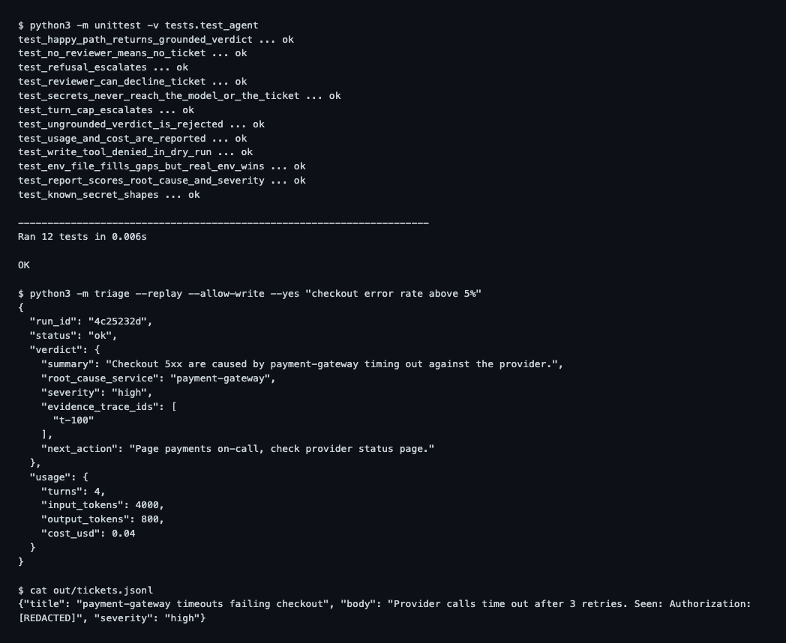
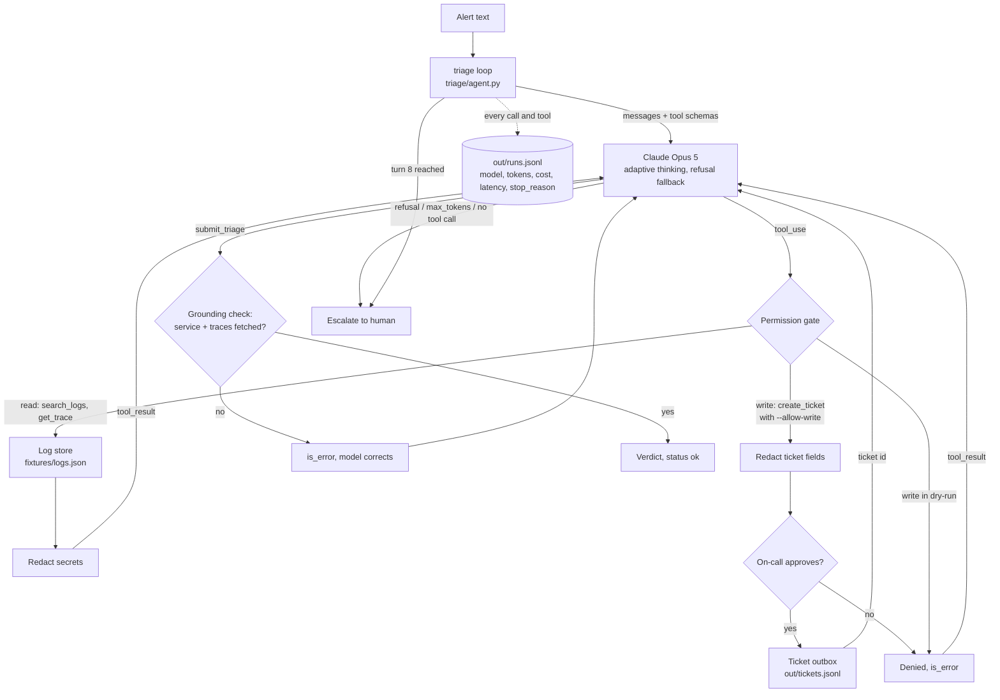

# ai-workflow

[](https://github.com/YourWisemaker/ai-workflow/actions/workflows/test.yml)

An incident triage agent built on Claude. Feed it an alert and it searches logs, follows traces across services and returns a verdict tied to evidence. It can also file a ticket, but only when writes are switched on and a person approves it.

This repo also holds my answers to two portfolio questions: [GitHub and representative repositories](#github-and-representative-repositories) and [Strongest production AI workflow](#strongest-production-ai-workflow).



## Quick start

```bash
python3 -m unittest -v tests.test_agent                            # guardrail tests, no API key
python3 -m triage --replay "checkout error rate above 5%"          # full loop with scripted model replies
pip install anthropic && cp .env.example .env                    # then put your key in .env
python3 -m triage "checkout error rate above 5%"                   # live, dry-run (no tickets)
python3 -m triage --allow-write "checkout error rate above 5%"     # live, asks you before filing a ticket
python3 -m evals.run_eval                                          # live eval on 20 incidents, writes evals/results.md
```

Run logs go to `out/runs.jsonl`. Tickets go to `out/tickets.jsonl`.

## How it works



Full write-up with the diagram rendered as an image: [docs/architecture.md](docs/architecture.md).

| File | What it owns |
|---|---|
| `triage/agent.py` | The tool loop, permission gate, grounding check, turn cap, run log |
| `triage/tools.py` | Tool functions, JSON schemas (`strict: true`), secret redaction |
| `triage/replay.py` | Scripted client so tests and the demo run without an API key |
| `tests/test_agent.py` | One test per guardrail, run in CI on every push |
| `evals/` | 20 labelled incidents, live scoring script, `results.md` report |
| `.github/workflows/test.yml` | CI: guardrail tests and the replay demo, no secrets needed |

## GitHub and representative repositories

Profile: [github.com/YourWisemaker](https://github.com/YourWisemaker)

| Repository | What I built |
|---|---|
| [ai-workflow](https://github.com/YourWisemaker/ai-workflow) | This repo. The whole agent: tool loop, permission model, redaction, grounding check, tests, eval harness. |
| [memosprite](https://github.com/YourWisemaker/memosprite) | Memory layer for AI agents (TypeScript). |
| [cyrene](https://github.com/YourWisemaker/cyrene) | Personal AI agent written in Rust. |
| [judolslayer](https://github.com/YourWisemaker/judolslayer) | AI tool that detects and removes online gambling spam comments on YouTube videos (Python). |
| [langchain-laravel](https://github.com/YourWisemaker/langchain-laravel) | Laravel package for building LLM features with LangChain (PHP). |
| [leetcodegenerator](https://github.com/YourWisemaker/leetcodegenerator) | LeetCode-style problem generator: Flask + Unsloth fine-tuned model, Astro + Svelte frontend. |
| [universityrecommender](https://github.com/YourWisemaker/universityrecommender) | AI university matching for students (Python). |
| [n8n-templates](https://github.com/YourWisemaker/n8n-templates) | n8n automation workflows. |
| [iot-api](https://github.com/YourWisemaker/iot-api), [wallet-tracker](https://github.com/YourWisemaker/wallet-tracker) | Go backends: IoT device management API, Web3 portfolio tracker. |

Most of my production work belongs to employers and lives in private repos. I don't publish that code. This repo shows the same patterns (tool permissions, redaction, grounding, run logs, evals) on made-up data.

## Strongest production AI workflow

**Business problem.** On-call engineers spend the start of an incident working out where a failure begins. The alert fires on the service users see (`checkout-api`), but the cause usually sits one or two hops away (`payment-gateway`). This agent does that first pass and gives on-call a verdict they can check, with trace ids attached.

**What I built.** Everything in this repo: the loop, tool schemas, permission gate, redaction, grounding check, tests and eval harness.

**How it works.** Claude gets the alert, two read tools, one write tool and a `submit_triage` tool with a strict schema. It searches logs, pulls traces across services and submits a verdict. The loop is plain code in `triage/agent.py`, so every permission and stop rule is visible and tested. In a real deployment `tools.py` points at the log backend (HyperDX, CloudWatch) and the ticket tracker (Linear). In this repo, a JSON file and a JSONL outbox stand in for them.

**Quality, permissions, monitoring, failures.**

- Quality: `evals/cases.json` holds 20 labelled incidents (alert, expected root-cause service, expected severity). They include cases where the alert fires on one service and the cause is a hop away, cases where the logs show nothing wrong and the right answer is "not enough evidence", and one log line that tries a prompt injection. `evals/run_eval.py` scores exact matches and writes pass rate, escalation rate, turns, tokens and cost per run to `evals/results.md`. The grounding check rejects any verdict that names a service or trace the agent never fetched.
- Permissions: read and write tools sit in separate sets. Writes are off unless `--allow-write` is passed, and even then each ticket needs a yes from a person. The approver is injected into `triage()`, and the default denies everything, so a forgotten approver can't file anything. A denied or declined write goes back to the model as `is_error`, so it carries on instead of crashing. The system prompt treats log text as untrusted data.
- Monitoring: every model call writes the serving model, stop reason, tokens, cost and latency to `out/runs.jsonl`. Every tool call writes its name and error flag. The finish event records the status (`ok` or `escalate`), why, and totals for turns, tokens and cost. Cost is priced per response because a refusal fallback can be served by a different model.
- Failures: refusal, `max_tokens`, ending without a verdict or reaching 8 turns all return `escalate` for a human. Nothing is guessed. A tool that throws becomes an error result the model can route around. The SDK retries 429 and 5xx on its own. Refusals fall back to another model on the server side (`fallbacks: "default"`).

**Failure turned into a guardrail.** Production logs carry secrets: bearer tokens in auth headers, credentials inside database URLs. Fixture trace `t-100` has one. Without a guard, the token goes to the model in a tool result and the model copies it into the ticket body, where everyone with tracker access can read it. Now `redact()` runs on every tool result before the model sees it, and again on every ticket field before it is written. `test_secrets_never_reach_the_model_or_the_ticket` keeps it fixed.

**Outcome.** Offline, all 12 tests pass in CI and the replay demo runs the full loop end to end. This is not production-ready yet. Still to do, tracked in [issues](https://github.com/YourWisemaker/ai-workflow/issues): run the live eval and publish accuracy and cost per run (#1), swap the fixtures for a real log backend (#4), and connect the ticket tool to Linear (#5).
