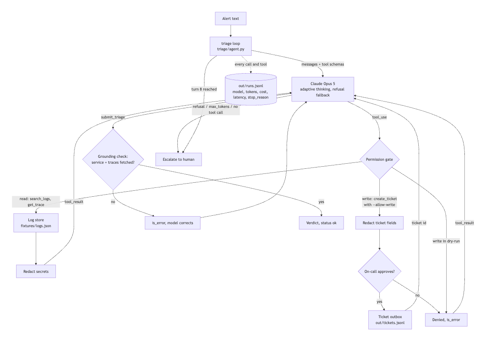
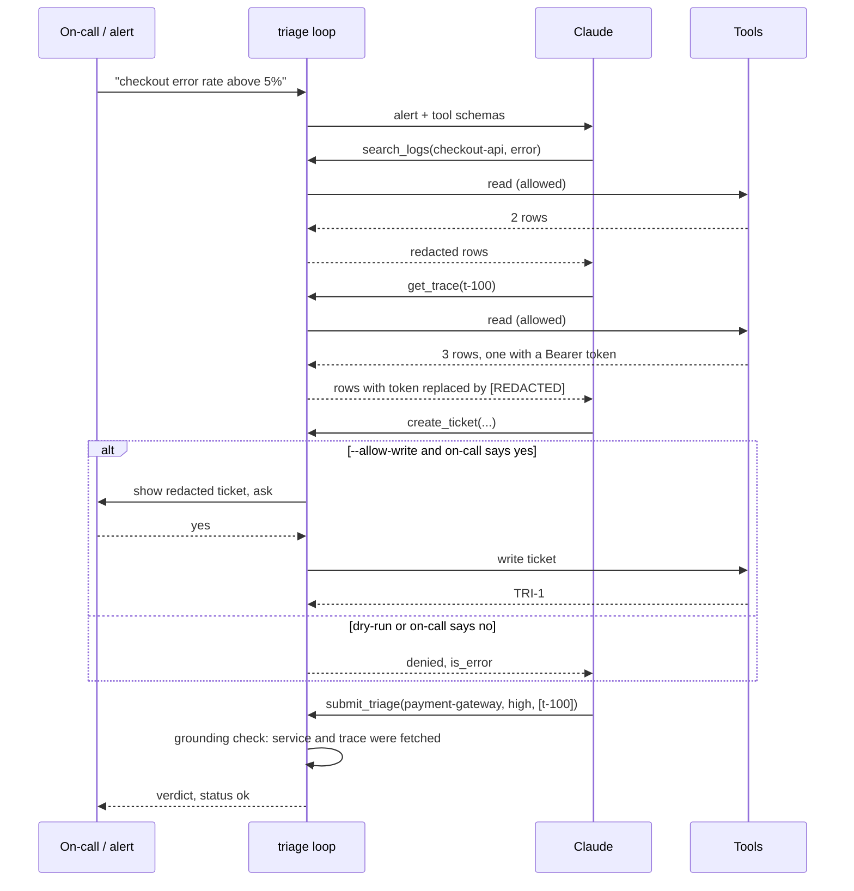

# Architecture

## Flow

Source for the diagram is the mermaid block in the [README](../README.md#how-it-works).

## One run, step by step

This is the replay demo (`python3 -m triage --replay --allow-write ...`). A live run follows the same path.

## Where each rule lives

| Rule | Code | Test |
|---|---|---|
| Writes off by default | `Run.call_tool`, `WRITE_TOOLS` in `triage/agent.py` | `test_write_tool_denied_in_dry_run` |
| A person approves every ticket, default deny | `approve` arg, `deny_all`, `ask_on_call` in `triage/__main__.py` | `test_reviewer_can_decline_ticket`, `test_no_reviewer_means_no_ticket` |
| Secrets never reach model or ticket | `tools.redact`, called in `Run.call_tool` | `test_secrets_never_reach_the_model_or_the_ticket` |
| Verdict must cite fetched evidence | `Run.check_verdict` | `test_ungrounded_verdict_is_rejected` |
| Bounded run | `MAX_TURNS` in the `triage()` loop | `test_turn_cap_escalates` |
| Refusal or truncation goes to a human | stop_reason check in `triage()` | `test_refusal_escalates` |
| Every call is observable, with cost | `Run.log`, `call_cost` | `test_usage_and_cost_are_reported` |
| Known secret shapes are caught | `SECRET_PATTERNS` in `triage/tools.py` | `test_known_secret_shapes` |
| Log text can't steer the agent | system prompt rule, injection case in `evals/cases.json` | live eval only |
| Eval report is computed right | `score`, `report` in `evals/run_eval.py` | `test_report_scores_root_cause_and_severity` |

## Choices

- Manual loop instead of the SDK tool runner. The permission gate and grounding check sit inline where a reviewer can read them, and the loop has no beta dependency apart from the refusal fallback.
- `strict: true` on every tool schema, so tool inputs always match the schema and the loop doesn't have to validate them.
- `submit_triage` is a tool, not free text. The verdict comes back as typed fields the grounding check can test.
- A replay client instead of mocks. Tests run the real loop, with only the model swapped out.
